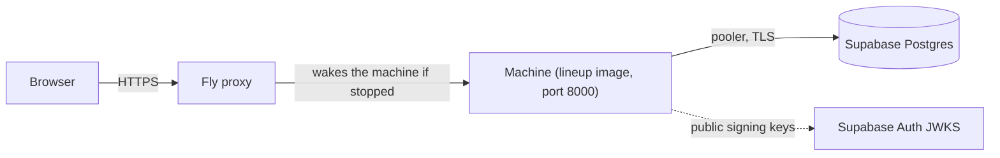
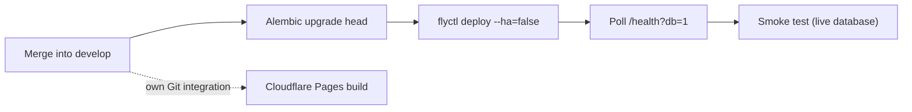

# Fly Setup

How the API runs on Fly.io and the one-off steps to create the dev app (`lineup-dev-lb`). The config
is committed (`backend/fly.toml`); this page is the manual part that needs your Fly account. You
need no prior Fly experience. Output formats change now and then, so follow the intent if a message
differs.

## What Fly does for us

Fly runs our Docker image (`backend/Dockerfile`) as a small virtual machine and puts an HTTPS proxy
in front of it. Three choices in `fly.toml` matter:

- **Scale to zero.** `auto_stop_machines = "stop"` and `min_machines_running = 0` stop the machine
  when nobody uses the API and start it on the next request. Idle costs close to nothing. The cost
  is a cold start: the first request waits a few seconds while the machine boots (the frontend
  shows a "server is starting up" banner, see *Current State: Frontend*).
- **Region `ams` (Amsterdam).** The dev Supabase project is in AWS `eu-west-1` (Ireland) and Fly
  has no Dublin region. Amsterdam is the closest EU region, and keeping both in the EU keeps
  personal data in the EU (GDPR).
- **1 GB of memory.** LibreOffice converts the `.docx` to PDF in a separate process that needs a
  few hundred MB, so `PDF_MAX_CONCURRENT` is `1` on this machine.



## One-off setup

Commands run from `backend/` (the Docker build context, like `task build`).

1. **Install the CLI and sign in.** Install `flyctl` ([fly.io/docs/flyctl/install](https://fly.io/docs/flyctl/install/)),
   then `fly auth signup` (or `fly auth login`). A new account starts a free trial without a card (see *Trial and billing* below).
2. **Create the app without deploying.** The name and region are already in `fly.toml`:

   ```
   cd backend
   fly apps create lineup-dev-lb
   ```

   App names are unique across **all** of Fly.io, not just your account, so a plain name like
   `lineup-dev` is already taken by someone else. That is why the name ends in `-lb`: the
   initials of the repo owner's GitHub handle (**L**aster**B**ergamot), added only to make the
   name unique. It has no technical meaning (it is *not* "load balancer"). If `lineup-dev-lb` is
   taken too, pick another and change `app` in `fly.toml` (and the URLs below).
3. **Sign the DPA** (the GDPR data processing agreement). It is **not** on the public
   [fly.io/legal](https://fly.io/legal) page. Per Fly's own
   [security questionnaire](https://fly.io/legal/security-questionnaire/) it is available on every
   plan, self-service, from the **Trust Center in the Fly dashboard** (Fly signs first; you sign
   through Dropbox Sign; the signed copy stays downloadable there). Can't find it? Ask
   compliance@fly.io. Fly acts as our processor for the app's data and is a sub-processor of the
   clubs' data, so it goes in the GDPR pack (#94).
4. **Set the secrets.** They are stored encrypted by Fly and never appear in git:

   ```
   fly secrets set --stage \
     DATABASE_URL='postgresql+asyncpg://lineup_app.<project-ref>:<password>@aws-0-<region>.pooler.supabase.com:6543/postgres?ssl=require' \
     SUPABASE_URL='https://<project-ref>.supabase.co' \
     CORS_ORIGINS='https://<your-pages-url>'
   ```

   - `DATABASE_URL` is the **transaction pooler** URL with the least-privilege `lineup_app` role,
     the same value as in your local `backend/.env`. Never the migration role.
   - `CORS_ORIGINS` is the frontend's address. Until the Cloudflare Pages site exists use
     `http://localhost:5173` and update it later with `fly secrets set CORS_ORIGINS=…`.
   - Invite links are built from `APP_BASE_URL`, which is **not** a secret and lives in `fly.toml`
     (`[env]`, the Cloudflare Pages URL). If the Pages URL ever changes, change it there and in `CORS_ORIGINS`.
   - `--stage` only stores the values; the first deploy picks them up.
   - Don't paste secrets into chat or issues. To read what is set (names only): `fly secrets list`.
5. **Deploy.**

   ```
   fly deploy --ha=false
   ```

   `--ha=false` matters on the **first** deploy: by default Fly creates two machines "for high
   availability", and we want exactly one. The API keeps its rate-limit counters in memory, so two
   machines would count separately and let through twice the limit, and the second one only
   doubles the cost. Later deploys update the machines that exist and don't add new ones. If you
   forgot the flag, `fly scale count 1` removes the extra machine.

   The first build takes a few minutes (LibreOffice). A failed health check keeps the previous
   release running.
6. **Check it.**

   ```
   curl https://lineup-dev-lb.fly.dev/health          # {"status":"ok"} (may take a few seconds after idle)
   curl 'https://lineup-dev-lb.fly.dev/health?db=1'   # 200 when the database answers, 503 if not
   ```

   Then, after the machine has been idle for at least 15 minutes, generate a PDF from the signed-in
   frontend: the first PDF has to finish within the 120 s conversion timeout.
7. **Add the dev frontend origin** to `CORS_ORIGINS` once Cloudflare Pages is up.
8. **Decide how to pay before the trial ends** and check the bill now and then; Fly has no billing
   alerts (see *Trial and billing* below).

After this one-off setup, deploys are automatic (see *Continuous deployment* below).

## Continuous deployment

`.github/workflows/deploy-dev.yml` (#8) deploys the API on every push to `develop` that changes
something under `backend/` (and can be started by hand from the Actions tab: *Deploy dev* → Run
workflow). In order, it:

1. applies the Alembic migrations (`alembic upgrade head`) to the dev Supabase project,
2. runs `flyctl deploy --ha=false` from `backend/`; if the new machine never passes Fly's `/health`
   check, Fly keeps the previous release and the job fails,
3. polls `GET /health?db=1` for up to three minutes (18 tries, 10 s apart), because the first answer
   after a deploy can be slow, and fails the job if the app never reports a working database,
4. in a second job, `smoke`, runs the live smoke test (#190, see below).



The frontend is **not** part of this workflow: Cloudflare Pages already builds and publishes
`develop` through its Git integration (*Pages Setup*), so a second deploy path would only add a
Cloudflare token to keep safe. The two deploys are independent and can finish in either order.

Because the migration runs before the release, a broken migration stops the deploy with the old
code still running. The opposite case (a good migration, then a failed release) leaves the old
code on the new schema, so write migrations that old code can live with: add columns and tables
in one deploy and drop the old ones in a later one.

Pushes that only change docs or the frontend do not trigger it, and runs never overlap or get
cancelled (`concurrency`): a second push waits for the first to finish.

### The smoke test after a deploy

The health check only proves the app can run `SELECT 1`. A migration or grant mistake that breaks a
real route (a missing `GRANT`, an RLS policy, a pooler quirk that SQLite cannot show) would pass it
and be found later by a user. So once the deploy is green, the `smoke` job (`needs: deploy`) runs
`scripts/smoke_live.py`, the same script as the `supabase-smoke` skill, against the dev database:

- It starts the API **from the checked-out code** on the runner, connected to the dev database through
  the Supabase transaction pooler as the least-privilege `lineup_app` role, so RLS and the grants are
  really exercised. It does not call the Fly app.
- Sign-in is a stand-in: `scripts/smoke_auth.py` serves a throw-away public key on `127.0.0.1` and
  writes two tokens (fixed smoke users, so the cleanup can find their rows). The key never leaves
  the runner and the real Supabase Auth is not involved.
- The script creates a team, a player and a saved lineup, reads them back, generates a DOCX and runs
  the invitation flow (create, preview, accept as a second user, revoke), then deletes everything. It
  names every row `smoke-<unix time> …` and, as a last step, deletes teams carrying that marker that
  are more than an hour old, so a crashed run does not leave data behind. Only synthetic data is
  written.
- A failed step fails the run (and the API log tail is printed). The deploy is already live by then;
  the red run is the signal and nothing is rolled back (the first version only reports).
- It runs only for pushes to `develop` (and a manual run on `develop`), never for pull requests.

To run it by hand, start the two helpers as `.claude/skills/supabase-smoke/SKILL.md` describes and
run `python3 scripts/smoke_live.py --token-file … --second-token-file …`. In CI, start it from the
Actions tab: *Deploy dev* → Run workflow on `develop` (that deploys first, then smoke-tests).

### One-off setup for CD

Three GitHub Actions secrets (repository → Settings → Secrets and variables → Actions → *New
repository secret*). Never paste their values into chat or issues.

| Secret | Value |
|---|---|
| `FLY_API_TOKEN` | An app-scoped deploy token. Create it with `fly tokens create deploy -a lineup-dev-lb` and paste the whole output (starting `FlyV1`). It can deploy this one app and nothing else. |
| `MIGRATE_DATABASE_URL` | The table-owner URL through the Supabase **session pooler** (port 5432), the same value as in your local `backend/.env.migrate`: `postgresql+asyncpg://postgres.<project-ref>:<password>@aws-0-<region>.pooler.supabase.com:5432/postgres?ssl=require`. The direct host is IPv6-only and GitHub's runners are IPv4, so use the pooler. Not the app's `lineup_app` URL, which cannot change the schema. |
| `SMOKE_DATABASE_URL` | The app's `lineup_app` URL through the Supabase **transaction pooler** (port 6543): `postgresql+asyncpg://lineup_app.<project-ref>:<password>@aws-0-<region>.pooler.supabase.com:6543/postgres?ssl=require`, the same value as the Fly secret `DATABASE_URL`. It is the only secret the `smoke` job gets, so the job cannot change the schema. |

To rotate one: create a new token or password, update the secret, then revoke the old one
(`fly tokens list`, `fly tokens revoke <id>`; for the database, change the `postgres` password in
the Supabase dashboard and update `backend/.env.migrate` and the secret together; when
`task db:create-app-role` rotates the `lineup_app` password, update the Fly secret `DATABASE_URL`,
`KEEPALIVE_DATABASE_URL` and `SMOKE_DATABASE_URL` together). The run fails
with an error message that names the secret if one of them is missing.

After setting the secrets, run *Deploy dev* by hand once and read the log. GitHub masks the token
and the URL in it, and the workflow reads them only through `env:`, so no command line contains them.

## Trial and billing

- **Trial.** A new Fly account gets a free trial without a card: "up to 2 hours of Machine runtime
  or 7 days, whichever comes first" ([pricing](https://docs.fly.io/about/pricing)). After that you
  must add a card or prepaid credits to keep using billable resources, otherwise the dev API stops
  working. Add one of them before the trial ends. Check the date and the remaining trial in the
  dashboard.
- **Prepaid credits instead of a card.** Without a card you can add credits; usage is subtracted
  from the balance each month ([billing](https://docs.fly.io/about/billing)). That is the closest
  thing to a spending cap, because the most it can cost is what you paid in. Check in the
  dashboard what happens when the balance runs out (Fly's docs don't say).
- **No billing alerts, no spending cap.** Fly says so itself: "We don't support billing alerts
  (yet), so budget accordingly" and "If you go over, we'll bill you"
  ([cost management](https://docs.fly.io/about/cost-management)). So look at the *current month to
  date bill* in the dashboard now and then (a recurring calendar reminder helps), and keep the
  setup small: one machine (`fly deploy --ha=false`), `shared-cpu-1x` with 1 GB, scale to zero,
  the free shared IPv4 (don't run `fly ips allocate-v4`). Estimate the worst case with
  [fly.io/calculator](https://fly.io/calculator).
- **Supabase** (free plan) can't bill you; it emails you when a quota is exceeded and restricts the
  project after a grace period. Make sure the organization's billing email is one you read.

## When the app stops and starts

Nothing keeps the Fly machine alive, on purpose:

- **Stops:** the Fly proxy stops the machine on its own after a few minutes without requests
  (`auto_stop_machines = "stop"`). A stopped machine costs almost nothing (only its disk).
- **Starts:** the next request to `https://lineup-dev-lb.fly.dev` starts it again
  (`auto_start_machines = true`). The proxy holds that request while the machine boots, so it is
  slow rather than failed: about 5 s for `/health` in a measured cold start (the first PDF is
  slower because LibreOffice starts too). The frontend also asks `/health` as soon as the page
  loads, which starts the machine while the user is still signing in.
- **The health check doesn't count.** Fly's `/health` check only runs on a machine that is already
  running; it neither wakes nor holds up a stopped one.
- **Different from Supabase.** The Supabase free tier pauses a project after about a week without
  *database activity* and does not wake on its own, which is why `keepalive.yml` pings it twice a
  week. Fly has no such rule: a stopped machine stays available and just starts on demand, so it
  needs no keep-alive. (If the keep-alive later calls `/health?db=1` on this app, it wakes the
  machine twice a week for a few seconds, which is harmless.)

## Everyday commands

| Command | What it does |
|---|---|
| `fly status` | Machine state (`started` / `stopped`) |
| `fly logs` | Live logs (never contain tokens or client IPs by design) |
| `fly secrets list` / `fly secrets set K=V` | Names of the secrets / change one (redeploys) |
| `fly machine list` | Machines and their regions |
| `fly deploy --ha=false` | Build and release the image from `backend/`, with a single machine |
| `fly releases` | History; the previous release stays active if a deploy fails its health check |

## When something is wrong

| Symptom | Likely cause |
|---|---|
| Deploy fails, machine exits at start | `ENV=production` makes startup fail closed: check that `DATABASE_URL` is a `postgresql+asyncpg` URL with `ssl=require` and that `SUPABASE_URL` is set (`fly logs` shows the reason, never the URL) |
| `503` on every data route | `SUPABASE_URL` missing or wrong |
| `/health?db=1` is `503` | Wrong password or URL, or the Supabase project is paused (see *Current State: Backend*). If `task db:create-app-role` was run again, it set a new `lineup_app` password: update the Fly secret `DATABASE_URL` (and the `KEEPALIVE_DATABASE_URL` Actions secret) from `backend/.env` |
| Browser says CORS error | The frontend's origin is not in `CORS_ORIGINS` (exact match, no trailing slash) |
| PDF requests answer `503` + `Retry-After` | Another conversion is running; one at a time on this machine |
| `fly machine list` shows two machines | The first deploy ran without `--ha=false`. Run `fly scale count 1` |
| Everyone shares one rate-limit bucket | `CLIENT_IP_HEADER` is missing from the environment |
