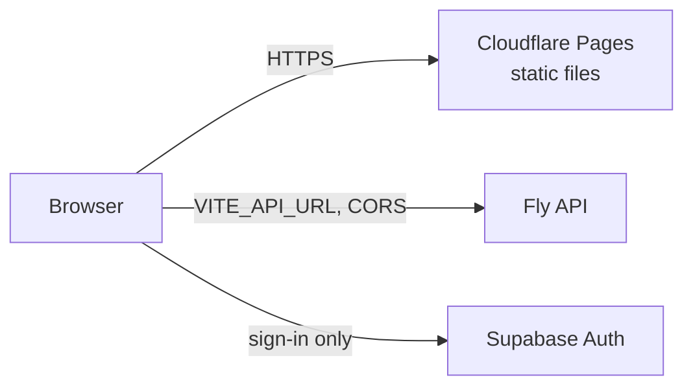

# Pages Setup

How the web app is hosted on Cloudflare Pages and the one-off steps to create the dev site. The
build is just `pnpm build` in `frontend/`, so there is little to configure; this page is the manual
part that needs your Cloudflare account. You need no prior Cloudflare experience. Screens and menu
names change now and then, so follow the intent if something differs.

## What Pages does for us

The frontend is a Vite single-page app: `pnpm build` produces plain static files (`frontend/dist`).
Cloudflare Pages serves them from its global network over HTTPS, builds them from the Git
repository, and gives every pull request its own preview URL. Three things matter:

- **Everything in the bundle is public.** The `VITE_*` build variables end up in the JavaScript that
  every visitor downloads. Only public values go in the Pages settings: the API address, the
  Supabase project URL and the Supabase **publishable** key. Never the Supabase secret key and
  never `DATABASE_URL` (the app also refuses a secret key at startup).
- **Deep links work without configuration.** Pages serves `index.html` for any unknown path as long
  as the project has no top-level `404.html`, so a link such as `/join/<code>` (Phase 5) reaches the
  React router. A test (`frontend/src/security-headers.test.ts`) fails if someone adds a
  `public/404.html`.
- **Security headers come from a file.** `frontend/public/_headers` is copied into the build and
  Pages sends those headers with every file: HSTS, `nosniff`, `Referrer-Policy: no-referrer`, a
  restrictive `Permissions-Policy` and `frame-ancestors 'none'`. This is the baseline; the strict
  Content-Security-Policy is tracked in #97.



## One-off setup

1. **Create a Cloudflare account** (a free plan is enough) at
   [dash.cloudflare.com](https://dash.cloudflare.com/sign-up).
2. **Accept the DPA.** Cloudflare is a processor for the visitors' IP addresses, so accept the
   [Cloudflare Customer DPA](https://www.cloudflare.com/cloudflare-customer-dpa/) (Account home →
   Legal, or follow that link while signed in) and list Cloudflare as a sub-processor in the GDPR
   pack (#94). The site stores no personal data; it only serves static files.
3. **Create the project.** Workers & Pages → Create → Pages → Connect to Git. When Cloudflare asks
   which repositories its GitHub app may read, choose **Only select repositories** and pick
   `LasterBergamot/lineup` only. Then set:

   | Setting | Value |
   |---|---|
   | Project name | `lineup-dev` (becomes `https://lineup-dev.pages.dev`; if taken, pick another and use it in the steps below) |
   | Production branch | `develop` |
   | Root directory | `frontend` |
   | Build command | `pnpm install --frozen-lockfile && pnpm build` |
   | Build output directory | `dist` |

4. **Pin the tool versions.** Settings → Variables and Secrets → add `NODE_VERSION` with the major
   version CI uses (CI runs the current Node LTS; check `actions/setup-node` in `ci.yml`). Pages
   takes the pnpm version from `packageManager` in `frontend/package.json`.
5. **Set the build variables** (Settings → Variables and Secrets, for both *Production* and
   *Preview*). They are all public:

   | Variable | Value |
   |---|---|
   | `VITE_API_URL` | `https://lineup-dev-lb.fly.dev` |
   | `VITE_SUPABASE_URL` | `https://<project-ref>.supabase.co` |
   | `VITE_SUPABASE_ANON_KEY` | the **publishable** key (Supabase → Project Settings → API) |
   | `VITE_COLD_START_NOTICE` | `true` |

   Variables are read at build time, so changing one needs a new deployment (Deployments → Retry,
   or push a commit).
6. **Leave Web Analytics off.** Pages offers a one-click Cloudflare Web Analytics beacon. It would
   add a third-party script and a cookie-free but still tracking-style request, so keep it disabled
   (project → Metrics). The privacy baseline (G14) is "no analytics or trackers".
7. **Tell the API about the new origin.** From `backend/`:

   ```
   fly secrets set CORS_ORIGINS='http://localhost:5173,https://lineup-dev.pages.dev'
   ```

   `CORS_ORIGINS` is an exact-match list: scheme and host, no trailing slash, no wildcards. Setting
   it restarts the machine.
8. **Tell Supabase Auth about it.** Supabase → Authentication → URL Configuration: set the **Site
   URL** to `https://lineup-dev.pages.dev` and keep `http://localhost:5173/**` and
   `https://lineup-dev.pages.dev/**` in the redirect allow-list (details in [[Auth Setup]]). The
   Google OAuth client needs no change, because Google redirects to Supabase, not to the app.
9. **Check it.** Open the Pages URL: the app shell loads at once, and the "server is starting up"
   banner appears while the API wakes. Sign in with Google. Open `/some/deep/link`: it should show
   the app (and its "not found" page), not a Cloudflare error. Then, after the API has been idle for
   at least 15 minutes, generate a PDF: it has to finish within 120 s (the first PDF shows the
   "generating" notice).

Automatic deploys from `develop` are the Git integration's job for now; CD (#8) later runs the
migrations and the Fly deploy first and then publishes the frontend.

## Pull request previews

Every pull request gets its own URL such as `https://<hash>.lineup-dev.pages.dev`, which is useful to
look at a change. **Sign-in and API calls do not work from a preview**: the origin is new for every
deployment, so it is not in `CORS_ORIGINS` (an exact-match list on purpose) and not in the Supabase
redirect allow-list. The preview shows the static UI and nothing more. To try a change end to end,
run it locally (`task fe:dev` against the local container) or merge it into `develop`.

## Troubleshooting

| Symptom | Likely cause |
|---|---|
| Build fails on `pnpm` or `node` | `NODE_VERSION` is too old, or the root directory is not `frontend` |
| Page loads but the app says sign-in is not configured | `VITE_SUPABASE_URL` / `VITE_SUPABASE_ANON_KEY` missing for that environment; fix and redeploy |
| Browser console: CORS error on API calls | The Pages origin is not in the Fly `CORS_ORIGINS` secret (exact match, no trailing slash) |
| Google sign-in returns to the wrong place or fails | The Pages URL is not the Supabase Site URL or not in the redirect allow-list |
| "Banner never goes away" | `VITE_API_URL` is wrong or the Fly machine is down: try `curl <VITE_API_URL>/health` |
| A deep link shows a Cloudflare 404 | A `404.html` was added to the build output; remove it |
