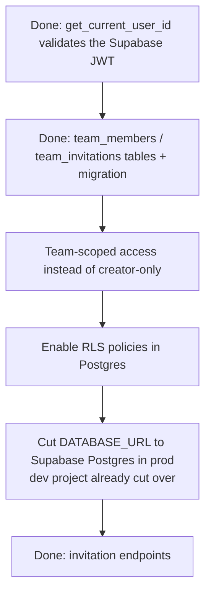

# Roadmap: Backend

Status: core persistence (Teams/Players/SavedLineups on the target snapshot schema) is
**done**, the app can already run against a **dev** Supabase Postgres project, requests are
authenticated with Supabase JWTs and the team-membership tables exist (see
[[Current State: Backend]]). Membership-based access and the invitation endpoints are done too;
team-scoped RLS and the production Supabase project are **not done yet**. (The current-state design — ERD, snapshot
strategy — lives in [[Current State: Backend]]; this page only covers what is still ahead.)

## Team collaboration: what is done and what is next

The tables exist (`team_members`, `team_invitations`, see the ERD in [[Current State: Backend]]),
creating a team adds its creator as an `owner` member, and **access is team membership**: a team is the
workspace, `players.team_id` and `saved_lineups.team_id` are required, and the rule everywhere is "the caller
is a member of the row's team" (`user_id` columns became the audit-only `created_by`). The opponent
directory lists only `id` + `name` of teams that chose to be listed, and `GET /teams/{id}/opponents/recent`
serves the recently used opponents. People join through multi-use invite links that expire (24 h by
default), can be revoked and are stored only as a SHA-256 hash; owners list members, remove them or
hand the team over, and anyone can leave (#51, see *Invitation links and members* in
[[Current State: Backend]]). The frontend for it (members page, `/join/:code`) is [[Roadmap: Frontend]].
Still ahead:

1. **Replace the interim RLS policy** (#21) with team-scoped ones using the same membership rule.

## Public exposure: what is done and what is left

Done in #96 (see *Hardening for public exposure* in [[Current State: Backend]]): security headers,
`Cache-Control: no-store`, a request body cap, rate limits on both generate endpoints, sign-in on
`POST /lineups`, API docs off in production and a startup check that refuses an insecure
`ENV=production` configuration; the invitation endpoints (#51) added their own limits and run behind
uvicorn's access log being off, because the invite code is a URL path segment. Still ahead:

- Scrub the invite code from request URLs in Sentry before any `SENTRY_DSN` is set (#93).
- Move the limiter's counters to a shared store before running more than one API instance (today they
  are per process, which is fine for a single scale-to-zero machine).
- Move `DATABASE_URL` from `ssl=require` (encrypted, certificate not checked) to `ssl=verify-full`
  with the Supabase CA once the production project exists; the startup check already accepts it.

## Supabase & OAuth integration

1. **Authentication**
   - *Code done:* `get_current_user_id()` (`backend/lineup/auth/dependencies.py`) validates the
     Bearer JWT against the project's JWKS and returns `sub`; every repository filters on the
     required user id (see [[Current State: Backend]]).
   - *Still manual (one-off, per project):* create the Google OAuth client and enable the Google
     provider in the Supabase dashboard — step by step in [[Auth Setup]].
2. **Production database cutover** *(parked: no prod environment is planned, #39/#100; the dev half is done)*
   - Done for dev: `asyncpg` is a dependency, the engine is dialect-aware, and the app runs
     against the `lineup-dev` Supabase project via `DATABASE_URL` (see
     [[Current State: Backend]]).
   - Still to do: create a separate `lineup-prod` Supabase project, run `alembic upgrade head`
     against it, and wire its `DATABASE_URL` + secrets into the deployment (paired with CD).

   This dev cutover is independent of the auth/RLS sequence below: the dev database can be
   used before any of steps 1, 3–5 exist.
3. **Row Level Security (RLS) in PostgreSQL**
   - *Done:* RLS is on for every table (deny by default), the `lineup_app` role exists and the
     API runs as it, with an interim allow-all policy (see [[Current State: Backend]]). The
     policies below replace that interim one.
   - `teams`: public read of `id` + `name` for `is_public = true` (powers the opponent pool); read/write
     restricted to team members (owners for changes).
   - `players` & `saved_lineups`: restricted to members of the row's team (`team_id`).
4. **Onboarding hook**
   - On first login, check if the user has an existing team or pending invitation.
   - If not, prompt for a team name → `POST /teams` (the caller becomes its `owner` member). This becomes
     the user's default team. (UI side of this is [[Roadmap: Frontend]].)
5. **Team invitations** — *done (#51)* in the link-based form: `POST /teams/{id}/invitations` creates a
   multi-use link, `GET /invitations/{code}` previews it and `POST /invitations/{code}/accept` joins
   (see [[Current State: Backend]]). An email-bound variant (the `email` column exists) is optional, later.

## Rollout sequencing

The order matters: the JWT check landed first, on its own, because it is small and reversible,
and team membership builds on a real user id. It is deliberately sequenced before the
Postgres/RLS cutover (steps D–E) so auth can be validated against SQLite first.
