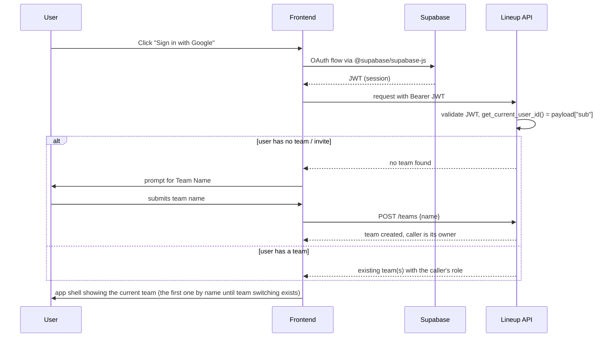

# Roadmap: Frontend

The frontend skeleton exists (see [[Current State: Frontend]]); this page records the decisions
behind it and what is still to come. The step-by-step plan, with issue numbers, is `PLAN.md`
(Phases 2-6); the backend side is in [[Roadmap: Backend]].

## Decisions

| Question | Decision | Why |
|---|---|---|
| Stack | React + TypeScript + Vite; Tailwind and shadcn-style components; TanStack Query; React Router; React Hook Form + Zod for forms; react-i18next; pdf.js for previews; Vitest + Playwright for tests | Mainstream choices with the most examples; nothing needs server-side rendering, so a static bundle is enough |
| API types | Generated from the backend's OpenAPI spec (openapi-typescript + openapi-fetch) | The two sides can't drift silently: CI fails when the generated client is stale |
| Hosting | Static files on Cloudflare Pages; the API on Fly.io (scale to zero) | Cheap, and a free tier is enough for a dev preview |
| Repository | Same repo, `frontend/` next to `backend/` | One PR can change an endpoint and its screen; CI treats each side separately |
| Auth | `@supabase/supabase-js` for Google sign-in only; all data goes through FastAPI, which validates the JWT | Supabase's Data API stays off, so there is one place for access rules |
| Theme | Polaris (deep teal, amber, square corners, light and dark) | Spec in `frontend/DESIGN.md` |
| Fonts | Self-hosted (Fontsource), no third-party requests | Google Fonts would send visitors' IPs to Google (GDPR, #97) |
| Language | Hungarian by default, English selectable (react-i18next, #155; **built**, the other Phase 6 screens add their texts to the two locale files) | The users and the generated document are Hungarian, and translating later would mean touching every screen twice. The choice is kept in localStorage (a strictly necessary preference, disclosed in the privacy notice, #94) |

## Where we are

Done: skeleton and tooling, the cold-start-aware data layer, the one-off lineup form that calls
`POST /lineups`, sign-in with team onboarding and the Hungarian / English UI (#155; see
[[Current State: Frontend]]); the real Google
sign-in still waits for the console setup in [[Auth Setup]]. The dev site is hosted on Cloudflare Pages (#175, see [[Pages Setup]]). Next (`PLAN.md`): automatic
deploys from `develop` (#8), invitations (Phase 5), then roster, lineup creator with previews and
saved lineups (Phase 6).

## OAuth / onboarding flow (built)

## Anticipated UI surfaces

These map directly onto existing/planned backend endpoints (see [[Current State: Backend]]
and [[Roadmap: Backend]]) — no new backend work is implied beyond what's already scoped
there:

- **Lineup creator** — builds a `POST /lineups` (one-off) or `POST /lineups/saved` (from
  roster) request; opponent field offers both `GET /teams/pool` autocomplete and free text.
- **Roster management** — **built** (#197): players CRUD, team settings (owners), opponent directory search. The opponent combobox of the lineup creator reuses `GET /teams/pool`.
- **Saved lineups list / "Clone to New Match"** — the list is **built** (#204): `/lineups/saved`
  newest first, PDF preview (hover intent or tap, cached in memory), PDF/DOCX download, delete,
  and "Clone to new match", which opens the Lineup page with the snapshot in the router state
  (`cloneFrom`). The creator side of the clone (#203) matches each player's `source_player_id`
  against the current roster: still-present players get pre-selected, deleted ones fall back to
  the frozen snapshot name/NSSZ as free text with a "no longer on roster" hint.
- **Team switching** — the Team page and the join flow (#189) work on "the current team", which is
  the first team by name. A user who joins a second team does not see it until switching exists.

## Still open

- The strict Content-Security-Policy for Cloudflare Pages (#97); the baseline headers are in `frontend/public/_headers` already.
- Whether the production API gets a custom domain (and so a same-site frontend) or stays on the
  provider's hostname.
